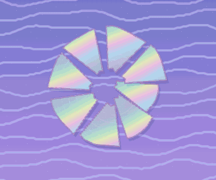
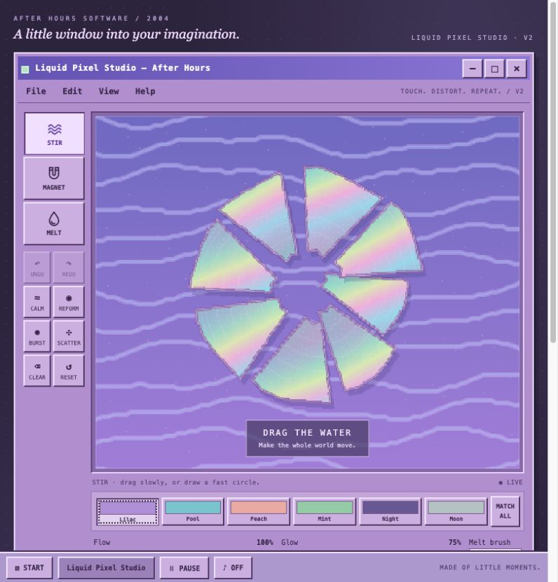

# Liquid Pixel Studio — Touch & Flow

A pastel 2000s desktop playground with liquid water, holographic CD fragments and three connected touch interactions.

**[Download the complete playable ZIP](https://github.com/wentaopeng714-cmd/liquid-pixel-studio/releases/download/v2.0.0/liquid-pixel-studio-v2.zip)**

解压后打开 `index.html` 即可试玩，不需要安装依赖。想交给 Loopit，可以复制 `code-for-loopit.txt` 的全部内容；它与 HTML 完全一致。

## Play

- **STIR:** drag across the water to push and rotate fragments. Curved strokes create spiral currents that also carry sparkles and melted pixels.
- **MAGNET:** hold for two seconds to assemble a reflective CD. Move while holding; release for a rainbow bloom.
- **MELT:** brush a fragment into flowing chrome pixels. Stir them, gather them with MAGNET, or let them find their way home.

The purple retro interface includes six palettes, flow/glow/brush controls, undo/redo, calm, reform, burst, scatter, clear, reset and an editable composition gallery.

## Record and share

Automatic capture keeps up to six seconds of actual canvas frames at 10 fps. Use **REC 6 SEC** for a fresh take, then **REPLAY & SHARE** to replay and export those exact frames as a GIF. PNG export is also available. System file sharing depends on browser support; download and image-saving fallbacks remain available.

GIF clips contain the captured gesture and may jump when they repeat. They do not contain audio. Recordings stay in session memory; download them to keep a copy. Local gallery entries preserve editable compositions, not raw recordings.

## Run and check

Open `index.html` in a modern browser. Everything is in one file with no external assets, libraries or API keys. Audio starts muted. All product text is English.

Optional model checks: `node check.cjs`.

The browser-tested example `actual-six-second-play.gif` contains 60 actual frames over six seconds. Mobile layout was checked at 390 × 844. Loopit integration and physical-device testing are still to be verified.

